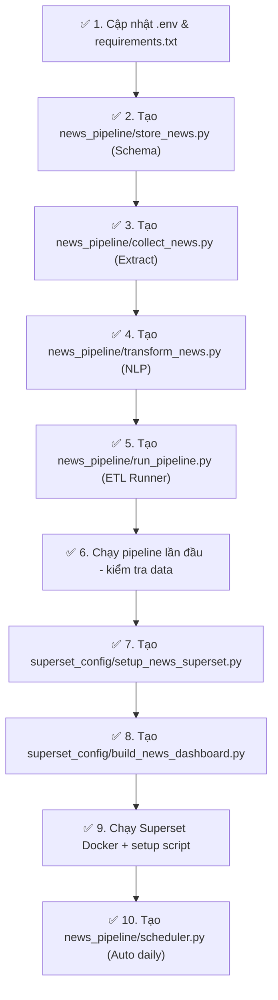

# 📋 Kế Hoạch Thực Hiện: NewsAPI + Apache Superset Pipeline

> **Dự án:** Data Engineering Pipeline – Theo dõi tin tức quốc tế về Việt Nam  
> **Workspace:** `wagtail_ai_crm` (btap3)  
> **Thời gian:** 2026-10-02  

---

## 🗺️ Tổng Quan Kiến Trúc

```
NewsAPI  ──►  Python ETL Script  ──►  SQLite DB  ──►  Apache Superset
              (Collect + NLP)         (news_vietnam)    (Dashboard)
```

Toàn bộ pipeline sẽ tích hợp vào **dự án Wagtail CRM hiện có**, tận dụng:
- Docker container Superset đã có (`docker-compose.superset.yml`)
- SQLite DB đã mount vào Superset (`db.sqlite3`)
- Superset setup script pattern đã có (`superset_config/`)

---

## ✅ Check List Chi Tiết

---

### ✅ Bước 1 — Thu thập dữ liệu từ NewsAPI

**Mục tiêu:** Viết script Python tự động lấy tin từ NewsAPI với từ khóa `Vietnam`.

**File cần tạo:** `news_pipeline/collect_news.py`

**Chi tiết thực hiện:**

```python
# Các thông tin cần cấu hình
NEWS_API_KEY = "0ef074c3cb824ad786d18a687454e30e"
KEYWORD     = "Vietnam"
LANGUAGE    = "en"
PAGE_SIZE   = 100  # tối đa free tier
ENDPOINT    = "https://newsapi.org/v2/everything"
```

**Dữ liệu thu thập (fields):**

| Field | Nguồn từ API | Ghi chú |
|---|---|---|
| `title` | `articles[].title` | Tiêu đề bài báo |
| `description` | `articles[].description` | Mô tả ngắn |
| `content` | `articles[].content` | Nội dung (truncated 200 ký tự ở free tier) |
| `url` | `articles[].url` | Đường dẫn gốc |
| `source_name` | `articles[].source.name` | Tên nguồn báo |
| `author` | `articles[].author` | Tác giả |
| `published_at` | `articles[].publishedAt` | Ngày xuất bản (ISO 8601) |

**Thư viện cần thêm vào `requirements.txt`:**
```
requests>=2.31.0          # đã có
textblob>=0.18.0           # sentiment analysis
spacy>=3.7.0               # NER (Named Entity Recognition)
schedule>=1.2.0            # auto scheduling daily
```

> [!NOTE]
> NewsAPI free tier giới hạn 100 requests/ngày và nội dung bị cắt 200 ký tự. Cần lưu cả `description` để bổ sung cho `content`.

---

### ✅ Bước 2 — Thiết kế CSDL & Lưu trữ

**Mục tiêu:** Thiết kế schema và lưu bài báo vào SQLite (dùng chung `db.sqlite3` đã mount vào Superset).

**File cần tạo:** `news_pipeline/models.py` + `news_pipeline/store_news.py`

#### 2.1 Schema bảng `news_vietnam_articles`

```sql
CREATE TABLE IF NOT EXISTS news_vietnam_articles (
    id              INTEGER PRIMARY KEY AUTOINCREMENT,
    title           TEXT NOT NULL,
    description     TEXT,
    content         TEXT,
    url             TEXT UNIQUE,          -- tránh duplicate
    source_name     TEXT,
    author          TEXT,
    published_at    DATETIME,
    collected_at    DATETIME DEFAULT CURRENT_TIMESTAMP,

    -- NLP Enrichment (Bước 3)
    sentiment_label TEXT,                 -- Positive / Negative / Neutral
    sentiment_score REAL,                 -- -1.0 → +1.0
    entities_org    TEXT,                 -- JSON list: tổ chức/công ty
    entities_gpe    TEXT,                 -- JSON list: địa danh
    entities_person TEXT                  -- JSON list: nhân vật
);

-- Index tối ưu cho BI queries
CREATE INDEX IF NOT EXISTS idx_published_at ON news_vietnam_articles(published_at);
CREATE INDEX IF NOT EXISTS idx_source_name  ON news_vietnam_articles(source_name);
CREATE INDEX IF NOT EXISTS idx_sentiment    ON news_vietnam_articles(sentiment_label);
```

#### 2.2 Chiến lược tránh trùng lặp (Deduplication)

- Dùng `url` làm **UNIQUE KEY** — `INSERT OR IGNORE` khi lưu.
- Log số bài mới / bài đã tồn tại sau mỗi lần chạy.

#### 2.3 File cấu trúc pipeline

```
news_pipeline/
├── __init__.py
├── collect_news.py      # Extract: gọi NewsAPI
├── transform_news.py    # Transform: clean + NLP
├── store_news.py        # Load: lưu vào SQLite
├── run_pipeline.py      # Entry point chạy toàn bộ ETL
└── scheduler.py         # Lên lịch chạy tự động hằng ngày
```

---

### ✅ Bước 3 — NLP: Sentiment Analysis & NER

**Mục tiêu:** Làm giàu dữ liệu với phân tích cảm xúc và nhận diện thực thể.

**File cần tạo:** `news_pipeline/transform_news.py`

#### 3.1 Làm sạch văn bản (Clean)
- Loại bỏ thẻ HTML với `re` hoặc `BeautifulSoup`.
- Loại bỏ ký tự đặc biệt, khoảng trắng thừa.
- Chuẩn hóa encoding UTF-8.

#### 3.2 Sentiment Analysis (TextBlob)

```python
from textblob import TextBlob

def get_sentiment(text):
    score = TextBlob(text).sentiment.polarity  # -1.0 → +1.0
    if score > 0.1:   return "Positive", score
    elif score < -0.1: return "Negative", score
    else:              return "Neutral",  score
```

| Score | Nhãn |
|---|---|
| > 0.1 | ✅ Positive |
| < -0.1 | ❌ Negative |
| -0.1 → 0.1 | ➖ Neutral |

#### 3.3 Named Entity Recognition (spaCy)

```python
import spacy, json
nlp = spacy.load("en_core_web_sm")

def extract_entities(text):
    doc = nlp(text)
    orgs    = [e.text for e in doc.ents if e.label_ == "ORG"]
    gpes    = [e.text for e in doc.ents if e.label_ == "GPE"]
    persons = [e.text for e in doc.ents if e.label_ == "PERSON"]
    return json.dumps(orgs), json.dumps(gpes), json.dumps(persons)
```

---

### ✅ Bước 4 — Kết nối Apache Superset với CSDL

**Mục tiêu:** Đăng ký database connection và tạo dataset trong Superset.

**File cần tạo:** `superset_config/setup_news_superset.py`  
*(theo pattern của `setup_crm_superset.py` đã có)*

#### 4.1 Cập nhật `docker-compose.superset.yml`

Thêm volume mount cho bảng news (SQLite đã dùng chung `db.sqlite3`, không cần thay đổi).

#### 4.2 Tạo Database Connection trong Superset

```python
# URI kết nối đến SQLite đã được mount
uri = "sqlite:////app/data/crm_db.sqlite3"
db_name = "Wagtail_CRM_DB"   # dùng chung connection đã có
```

> [!IMPORTANT]
> Bảng `news_vietnam_articles` nằm cùng file `db.sqlite3` với CRM tables → **không cần tạo thêm Database connection mới**, chỉ cần tạo thêm Dataset.

#### 4.3 Tạo Datasets trong Superset

| Dataset | Loại | Mô tả |
|---|---|---|
| `news_vietnam_articles` | Physical | Bảng gốc toàn bộ tin tức |
| `news_daily_summary` | Virtual (SQL) | Tổng hợp tin theo ngày |
| `news_source_ranking` | Virtual (SQL) | Xếp hạng nguồn báo |
| `news_sentiment_breakdown` | Virtual (SQL) | Phân tích cảm xúc |

**SQL cho Virtual Datasets:**

```sql
-- news_daily_summary
SELECT DATE(published_at) AS date,
       COUNT(*) AS article_count
FROM news_vietnam_articles
GROUP BY DATE(published_at)
ORDER BY date;

-- news_source_ranking
SELECT source_name,
       COUNT(*) AS article_count,
       ROUND(AVG(sentiment_score), 3) AS avg_sentiment
FROM news_vietnam_articles
GROUP BY source_name
ORDER BY article_count DESC
LIMIT 20;

-- news_sentiment_breakdown
SELECT sentiment_label,
       COUNT(*) AS count,
       ROUND(COUNT(*) * 100.0 / (SELECT COUNT(*) FROM news_vietnam_articles), 1) AS pct
FROM news_vietnam_articles
GROUP BY sentiment_label;
```

---

### ✅ Bước 5 — Xây dựng Dashboard trên Superset

**Mục tiêu:** Tạo Dashboard `🗞️ Vietnam News Intelligence` với các charts phân tích.

**File cần tạo:** `superset_config/build_news_dashboard.py`  
*(theo pattern của `build_dashboard.py` đã có)*

#### 5.1 Danh sách Charts cần tạo

| # | Tên Chart | Loại | Dataset | Mô tả |
|---|---|---|---|---|
| 1 | **Xu hướng tin tức theo ngày** | Line Chart | `news_daily_summary` | Time-series số lượng bài/ngày |
| 2 | **Nguồn tin phổ biến nhất** | Bar Chart | `news_source_ranking` | Top 10 nguồn báo theo số bài |
| 3 | **Phân bố cảm xúc** | Pie Chart | `news_sentiment_breakdown` | Tỷ lệ Positive/Negative/Neutral |
| 4 | **Từ khóa nổi bật** | Word Cloud | `news_vietnam_articles` | Từ xuất hiện nhiều trong tiêu đề |
| 5 | **Bảng tin mới nhất** | Table | `news_vietnam_articles` | Top 20 tin gần nhất, có link |
| 6 | **Điểm cảm xúc trung bình theo nguồn** | Bar Chart | `news_source_ranking` | avg_sentiment theo source_name |

#### 5.2 Layout Dashboard

```
┌─────────────────────────────────────────────────────┐
│  🗞️  VIETNAM NEWS INTELLIGENCE DASHBOARD             │
│  [Filter: Date Range] [Filter: Source] [Sentiment]  │
├──────────────────────────┬──────────────────────────┤
│  📈 Xu hướng tin / ngày  │  🏆 Top nguồn báo        │
│     (Line Chart)         │     (Bar Chart)           │
├────────────┬─────────────┴──────────────────────────┤
│ 🥧 Cảm xúc │  ☁️  Word Cloud tiêu đề               │
│ (Pie Chart)│                                         │
├────────────┴────────────────────────────────────────┤
│  📊 Điểm cảm xúc theo nguồn (Bar Chart)             │
├─────────────────────────────────────────────────────┤
│  📋 Danh sách tin mới nhất (Table)                  │
└─────────────────────────────────────────────────────┘
```

---

## 📁 Cấu Trúc File Cần Tạo

```
wagtail_ai_crm/
├── news_pipeline/                     ← MỚI
│   ├── __init__.py
│   ├── collect_news.py                # Bước 1: Extract từ NewsAPI
│   ├── transform_news.py              # Bước 3: NLP (Sentiment + NER)
│   ├── store_news.py                  # Bước 2: Schema + Load vào SQLite
│   ├── run_pipeline.py                # Entry point ETL toàn bộ
│   └── scheduler.py                   # Chạy tự động hằng ngày
├── superset_config/
│   ├── setup_crm_superset.py          # đã có (CRM)
│   ├── setup_news_superset.py         ← MỚI: Dataset cho News
│   ├── build_dashboard.py             # đã có (CRM)
│   └── build_news_dashboard.py        ← MỚI: Dashboard News
├── .env                               # Thêm NEWS_API_KEY
├── requirements.txt                   # Thêm textblob, spacy, schedule
└── docker-compose.superset.yml        # Giữ nguyên (SQLite dùng chung)
```

---

## ⚙️ Cập Nhật Cấu Hình

### `.env` — Thêm API Key
```env
# NewsAPI Configuration
NEWS_API_KEY=0ef074c3cb824ad786d18a687454e30e
NEWS_KEYWORD=Vietnam
NEWS_LANGUAGE=en
NEWS_PAGE_SIZE=100
```

### `requirements.txt` — Thêm thư viện NLP
```
textblob>=0.18.0
spacy>=3.7.0
schedule>=1.2.0
```

---

## 🚀 Thứ Tự Thực Hiện



---

## 🔑 Thông Tin Quan Trọng

| Thông tin | Giá trị |
|---|---|
| NewsAPI Key | `0ef074c3cb824ad786d18a687454e30e` |
| Từ khóa tìm kiếm | `Vietnam` |
| Database | SQLite (`db.sqlite3`) — dùng chung với CRM |
| Superset URL | `http://localhost:8088` |
| Superset Admin | `admin` / `admin` |
| SQLite mount path | `/app/data/crm_db.sqlite3` (trong Docker) |

> [!WARNING]
> API Key NewsAPI được công khai trong tài liệu này chỉ cho mục đích học tập. Trong môi trường thực tế, **không bao giờ** commit API Key lên Git. Luôn đọc từ biến môi trường `.env`.

---

*Sẵn sàng triển khai — Bắt đầu từ Bước 1 khi có lệnh.*
